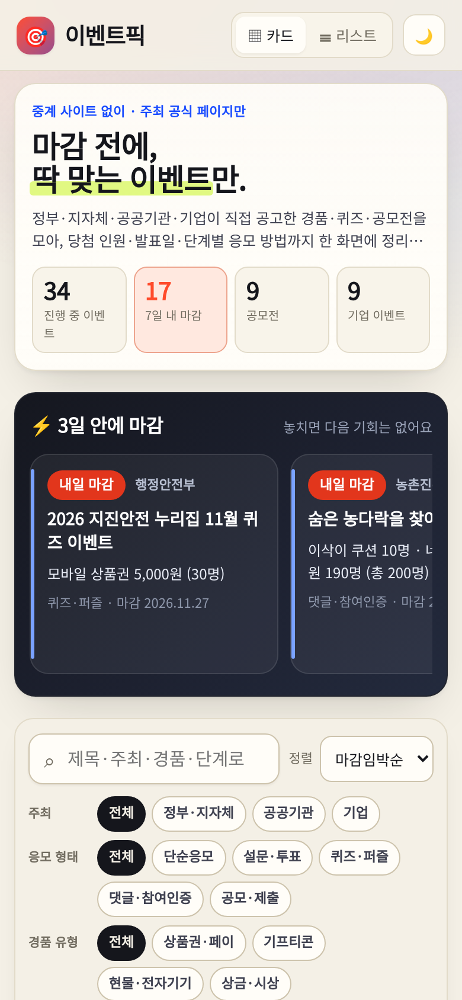

# 이벤트픽 (Event Pick) v2.0

정부·지방자치단체·공공기관·기업이 **직접 공고한** 경품 이벤트 · 퀴즈 · 공모전을 한 보드에 모으는 사이트입니다.
중계·목록 사이트는 수집하지 않고, 모든 항목의 `공식 원문` 버튼은 **주최가 운영하는 응모·공고 페이지**로 바로 연결됩니다.

- 라이브: **https://event-pick.pages.dev** (Cloudflare Pages)
- 저장소: `hijun67/261125-event-pick`
- 기준일: 2026-11-26 (KST)

## 화면 캡처

| 데스크톱 1440px | 모바일 390px | 상세 모달(모바일) |
|---|---|---|
|  |  |  |

## v2.0에서 바뀐 것

1. **중계 사이트(eventhouse.kr) 완전 제거** — 소스·파서·데이터·링크에서 모두 삭제했습니다. `npm test`가 데이터·sources·수집 스크립트에서 해당 문자열 0건을 검사합니다.
2. **공식 원문 직행 수집** — 서울시 `내 손안에 서울`(이벤트·공모전), 행정안전부 `모두의 광장`, 한국관광공사 `관광e배움터`만 자동 수집합니다. 각 목록에서 항목별 상세 페이지까지 읽어 주최·결과발표일·참여대상·공식 응모처를 채웁니다. 기업 이벤트는 각 기업의 공식 페이지를 직접 열어 확인한 항목(`공식 확인`)으로 넣습니다.
3. **이벤트하우스와 대등한 정보 밀도** — 당첨 인원, 발표일, 단계별 응모 방법(①→②→③), 유의사항, 참여 대상, 응모 형태, 경품 유형을 카드·상세 모달·정적 상세 페이지에 구조화했습니다.
4. **완전히 다른 UI** — 게시판형 목록이 아니라 매거진 대시보드형 보드입니다. D-3 마감 하이라이트 스트립, 요약 지표, 4종 세분 필터, 카드/리스트 보기 전환, 다크/라이트 테마, 찜·참여 완료 기록(localStorage)을 갖췄습니다.

## 화면

| 요소 | 설명 |
|---|---|
| 히어로 요약 | 진행 중 건수 · 7일 내 마감 · 공모전 · 기업 이벤트 수 |
| ⚡ 3일 안에 마감 | D-3 이내 항목만 가로 스트립으로 강조 |
| 키워드 검색 | 제목·주최·경품·응모 방법·태그·분류를 실시간 AND 검색 |
| 주최 필터 | 전체 / 정부·지자체 / 공공기관 / 기업 |
| 응모 형태 필터 | 전체 / 단순응모 / 설문·투표 / 퀴즈·퍼즐 / 댓글·참여인증 / 공모·제출 |
| 경품 유형 필터 | 전체 / 상품권·페이 / 기프티콘 / 현물·전자기기 / 상금·시상 |
| 상태 필터 | 전체 / 진행중 / 마감임박 D-7 / 내 찜·참여완료 |
| 정렬 | 마감임박순(기본) / 최신등록순 |
| 보기 전환 | 카드 보기 / 리스트 보기 (선택값 유지) |
| 테마 | 라이트(기본) / 다크 토글 (선택값 유지, 새로고침 유지) |
| 카드 | 주최 구분 점, D-day 칩, 응모 형태·경품 유형 칩, 경품 + 당첨 인원, 마감·발표일, 찜·참여·자세히·공식 원문 |
| 상세 모달 | 응모 기간·당첨 인원·발표일·응모 형태·경품 유형·참여 대상, 경품, 단계별 응모 타임라인, 유의사항, 공식 원문·링크 복사 |
| 상세 페이지 `/e/{id}.html` | 검색 유입용 정적 페이지 + `Event` 구조화 데이터 |
| 찜·참여 완료 | 이 브라우저 `localStorage`에만 저장(서버 전송 없음) |

## 데이터

- `data/events.json` — 사이트의 원본 데이터. `source`가 `자동수집`이 아닌 항목은 **주최 공식 페이지를 직접 열어 확인한 항목**입니다(`verifiedAt`).
- 필드: `title, organizer, category, type, start, end, announceDate, announceNote, winners, prize, howTo, steps[], cautions, target, url, tags[], verifiedAt, source, sourceLabel`
- 응모 형태(`entryType`)·경품 유형(`prizeType`)·당첨 인원은 `src/lib.mjs`가 값에서 유도하고, 빌드 결과(`public/data/events.json`)에 계산해 넣습니다.
- 마감일이 지난 항목은 수집·빌드 단계에서 자동으로 빠집니다. 발표일·경품을 확인하지 못한 항목은 `원문 공고 확인`·`원문 확인`으로 표시합니다.

## 명령

```bash
npm run collect   # sources.json의 공식 공개 페이지를 읽어 data/events.json 갱신 (검증 항목 유지, 마감 지난 항목 정리)
npm run build     # public/ 에 목록·상세 페이지·sitemap.xml·robots.txt·data 생성
npm test          # 수집 파서·데이터·필터·찜/참여 상태·렌더링·빌드 산출물 검사 (110개, 네트워크 불필요)
npm run serve     # 로컬 확인 http://127.0.0.1:4173
```

`SITE_URL` 환경변수로 배포 주소를 바꿉니다(기본 `https://event-pick.pages.dev`). `TODAY=YYYY-MM-DD`로 기준일을 고정해 빌드할 수 있습니다.

## 수집 소스 (`sources.json`)

| 소스 | 파서 | 주최 구분 | 읽는 것 |
|---|---|---|---|
| 서울시 내 손안에 서울 이벤트 | `seoulEvent` | 정부·지자체 | 목록의 기간 + 상세의 주최·결과발표일·참여대상·공식 누리집·경품·단계·유의사항 |
| 서울시 내 손안에 서울 공모전 | `mediahub` | 정부·지자체 | 공모 기간 + 상세의 결과발표일·접수처·시상 내역 |
| 행정안전부 모두의 광장 설문·투표 | `modu` | 정부·지자체 | 경품성 설문·투표만 (일반 정책 설문 제외) |
| 한국관광공사 관광e배움터 | `touredu` | 공공기관 | 수강·수료 이벤트 |

서울시 상세 페이지는 schema.org `Event` 구조화 데이터(JSON-LD)를 읽어 주최·기간·결과발표·참여대상을 정확히 가져옵니다. 수집은 공개 페이지만 읽고 로그인·CAPTCHA 우회는 하지 않으며, 한 소스가 실패하면 그 소스의 기존 데이터를 유지합니다.

기업 이벤트(현대자동차·카카오뱅크·티켓베이·봉이·동아일보·대원씨아이·매경·밀리의서재 등)는 기업별 이벤트 화면이 스크립트로만 열리는 경우가 많아, **주최 공식 페이지를 직접 열어** 경품·인원·발표일·응모 단계를 확인한 뒤 `공식 확인` 항목으로 넣습니다.

## 배포

Cloudflare Pages 정적 배포입니다(`public/` 업로드). 프로젝트는 Git 연동이 아니라 **직접 업로드** 방식이라, 갱신할 때는 `npm run update` 뒤 아래 명령을 다시 실행합니다.

```bash
npx wrangler pages deploy public --project-name=event-pick
```

## 원칙

- 응모·제출은 원문 페이지에서 직접 합니다. 이 사이트는 대신 응모하지 않고 결제·개인정보 제출도 하지 않습니다.
- 중계·목록 사이트는 수집도, 링크도 하지 않습니다.
- 확인하지 못한 경품·일정은 넣지 않습니다. 경품과 마감일은 주최 측 사정으로 바뀔 수 있으니 응모 전 원문 공고를 다시 확인하세요.
