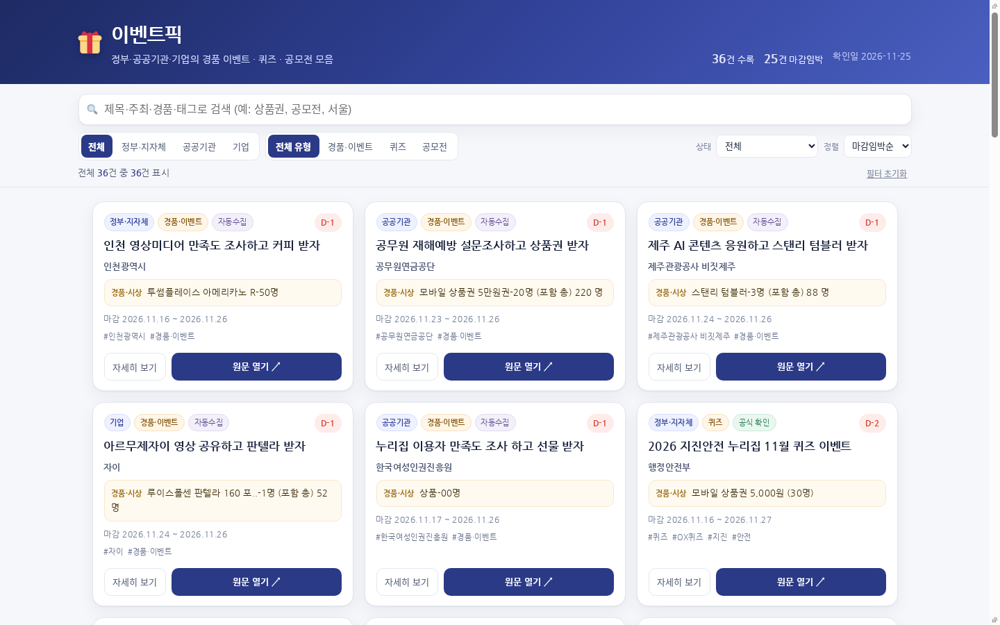
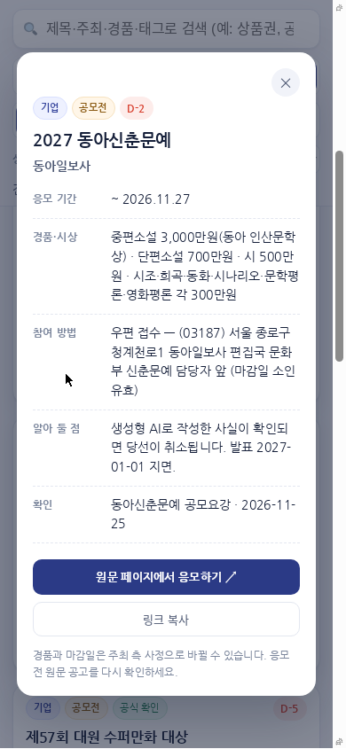

# 이벤트픽 (Event Pick)

정부·지방자치단체·공공기관·기업이 여는 **경품 이벤트 · 퀴즈 · 공모전**을 한 목록으로 모아 보여 주는 사이트입니다.
각 항목은 주최 공식 페이지를 직접 열어 제목·주최·마감일·경품·참여 방법을 확인하고 확인일을 남깁니다.

- 라이브: **https://event-pick.pages.dev** (Cloudflare Pages)
- 저장소: `hijun67/261125-event-pick`
- 기준일: 2026-11-25 (KST)

## 화면 캡처

| 데스크톱 1440px | 모바일 390px | 상세 모달(모바일) |
|---|---|---|
|  |  |  |

## 화면

| 요소 | 설명 |
|---|---|
| 키워드 검색 | 제목·주최·경품·참여 방법·태그를 실시간으로 검색 (여러 단어 AND) |
| 주최 필터 | 전체 / 정부·지자체 / 공공기관 / 기업 |
| 유형 필터 | 전체 / 경품·이벤트 / 퀴즈 / 공모전 |
| 상태 필터 | 전체 / 진행중 / 마감임박(D-7 이내) |
| 정렬 | 마감임박순(기본) / 최신등록순 |
| 카드 | D-day 배지, 주최, 경품·시상, 마감일, 태그, `원문 열기` |
| 상세 모달 | 기간, 경품·시상, 참여 방법, 유의점, 확인 출처 + 원문 링크·링크 복사 |
| 상세 페이지 `/e/{id}.html` | 검색 유입용 정적 페이지 + `Event` 구조화 데이터 |

## 데이터

- `data/events.json` — 사이트의 원본 데이터. `source`가 `자동수집`이 아닌 항목은 **직접 열어 확인한 검증 항목**입니다(확인일 `verifiedAt`).
- 마감일이 지난 항목은 빌드와 수집 단계에서 자동으로 빠집니다.
- 자동 수집 항목에는 카드에 `자동수집` 표시가 붙고, 원문 응모 주소가 로그인 뒤에만 열리는 소스는 목록 페이지로 연결합니다.

## 명령

```bash
npm run collect   # sources.json의 공개 목록을 읽어 data/events.json 갱신 (검증 항목 유지, 마감 지난 항목 정리)
npm run build     # public/ 에 목록·상세 페이지·sitemap.xml·robots.txt 생성
npm test          # 수집 파서·데이터·화면 로직·빌드 산출물 검사 (54개 항목, 네트워크 불필요)
npm run serve     # 로컬 확인 http://127.0.0.1:4173
```

`SITE_URL` 환경변수로 배포 주소를 바꿉니다(기본 `https://event-pick.pages.dev`). `TODAY=YYYY-MM-DD`로 기준일을 고정해 빌드할 수 있습니다.

## 수집 소스 (`sources.json`)

| 소스 | 파서 | 무엇을 읽나 |
|---|---|---|
| 이벤트하우스 웹사이트 경품이벤트 | `eventhouse` | 공공기관·지자체·기업 설문·투표·퀴즈 경품 이벤트의 주최·경품·기간 |
| 서울시 내 손안에 서울 공모전 | `mediahub` | 서울시 공모전 목록(상세 공고로 연결) |
| 행정안전부 모두의 광장 설문·투표 | `modu` | 정부·지자체 국민 설문 중 경품성 이벤트 |
| 한국관광공사 관광e배움터 | `touredu` | 수강·수료 이벤트 |

수집은 공개 페이지만 읽고, 로그인·CAPTCHA 우회는 하지 않습니다. 한 소스가 실패하면 그 소스의 기존 데이터를 유지합니다.

## 배포

Cloudflare Pages 정적 배포입니다(`public/` 업로드). `public/_headers`에 기본 보안 헤더가 들어 있습니다.
프로젝트는 Git 연동이 아니라 **직접 업로드** 방식이라, 갱신할 때는 `npm run update` 뒤 아래 명령을 다시 실행합니다.

```bash
npx wrangler pages deploy public --project-name=event-pick
```

## 원칙

- 응모·제출은 원문 페이지에서 직접 합니다. 이 사이트는 대신 응모하지 않고 결제·개인정보 제출도 하지 않습니다.
- 확인하지 못한 경품·일정은 넣지 않습니다. 경품과 마감일은 주최 측 사정으로 바뀔 수 있으니 응모 전 원문 공고를 다시 확인하세요.
